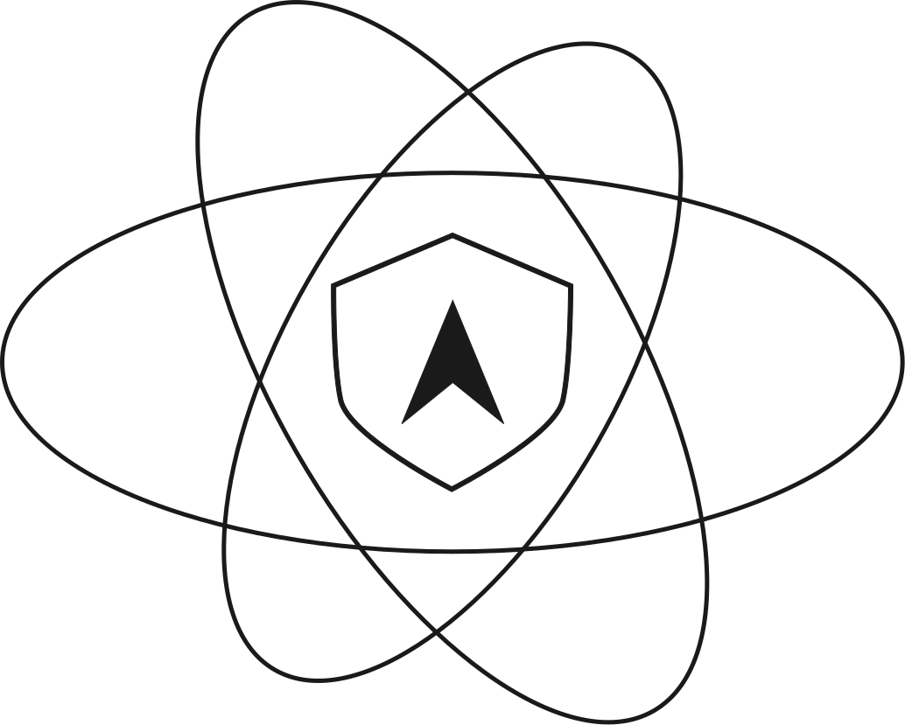

<p align="center">
  <a href="https://ngatoms.com">
    <picture>
      <source media="(prefers-color-scheme: dark)" srcset="https://raw.githubusercontent.com/ngAtoms/ngatoms/main/apps/docs/src/assets/ngatoms-logo-w.svg" width="160" />
      
    </picture>
  </a>
</p>

<h1 align="center">NgAtoms</h1>

<p align="center">Angular UI primitives you own.<br/>No runtime dependency — copy components directly into your project.</p>

<p align="center">
  <a href="https://ngatoms.com"></a>
  <a href="https://www.npmjs.com/package/ngatoms"></a>
  
  
</p>

---

## What is NgAtoms

NgAtoms is a set of Angular UI components that you copy into your own project instead of installing as a dependency. A small CLI downloads the source of each component, so the code is yours to read, change and keep. There is no runtime package to update and no library API to wait on.

NgAtoms is MIT-licensed and will always be free.

Documentation and live previews: **[ngatoms.com](https://ngatoms.com)**.

## Quick Start

```bash
# 1. Initialize your project
npx ngatoms init

# 2. Add a component
npx ngatoms add button
```

`init` creates `ngatoms.json` (config), a default theme file, and wires it into your styles.
`add <component>` fetches the component source from GitHub and copies it into your `componentsDir`.

## Requirements

- Angular 22 or later (`@angular/core` and `@angular/common` `>=22.0.0`)
- Node.js 22.22.3, 24.15 or 26 and later (required by Angular 22)

## Components

Components are marked `stable` or `alpha`.

| Component | Description | Status |
|-----------|-------------|--------|
| `accordion` | Collapsible items, single or multiple mode |  |
| `alert` | Feedback messages — 5 variants |  |
| `avatar` | Image with fallback initials or icon |  |
| `badge` | Labels — 8 variants: default, ember, success, warning, destructive, info, solid, outline |  |
| `button` | 5 variants, 5 sizes, loading state, icon support |  |
| `card` | Container with header, content, footer slots |  |
| `checkbox` | Checked, unchecked, and indeterminate states |  |
| `date-picker` | Custom calendar overlay — single/range, min/max, i18n, month/year picker |  |
| `dialog` | Modal using native `<dialog>`, focus trap, backdrop |  |
| `dropdown-menu` | Contextual action menu — 4 placements, flip, icons, keyboard navigation |  |
| `input` | 3 variants, 5 sizes, invalid state |  |
| `number-input` | Numeric input with increment/decrement controls |  |
| `overlay` | Shared overlay plumbing, installed automatically with the components that need it |  |
| `popover` | Floating content anchored to a trigger — 4 placements, flip |  |
| `progress` | Progress bar — determinate and indeterminate |  |
| `radio-group` | Radio button group with keyboard navigation |  |
| `select` | Custom select list — 3 variants, 5 sizes, invalid state |  |
| `separator` | Horizontal or vertical divider |  |
| `spinner` | Loading spinner |  |
| `switch` | Toggle switch — 3 sizes |  |
| `tabs` | Underline and pills variants, keyboard navigation |  |
| `textarea` | Multiline input with auto-resize |  |
| `tooltip` | Floating label — 4 placements, viewport clamping |  |
| `grid` | Data grid with tree rows, column groups, pinned columns, filters, sorting, editing, range selection and virtualization |  |
| `grid-core` | Framework-free models behind the grid, installed automatically with it |  |

**Stability.** The public API of a `stable` component follows semver: it changes only in a major release. A component marked `alpha` is outside semver and can change in a minor or patch release. Today that is `grid` and `grid-core`, including the exported helpers `fillDownChanges` and `fillFromChanges`.

## Design tokens

The colors, spacing, radii, shadows, fonts and other design values are CSS variables (prefixed `--nga-`), published as [`@ngatoms/ngatoms-tokens`](https://www.npmjs.com/package/@ngatoms/ngatoms-tokens). The theme file that `init` creates contains them, so you can restyle the components by changing variables.

## Configuration

`init` writes `ngatoms.json`:

```json
{
  "componentsDir": "src/components",
  "stylesFile": "src/styles.css",
  "themes": ["src/themes/default.css"]
}
```

## Monorepo structure

```
ngatoms/
├─ packages/
│  ├─ ngatoms        # Published CLI
│  ├─ primitives     # Angular UI primitive components
│  ├─ tokens         # Design tokens / CSS variables
│  ├─ cli            # Placeholder, not published
│  └─ utils          # Shared utilities
├─ apps/
│  ├─ docs           # Documentation site → ngatoms.com
│  └─ example        # Example app
├─ registry/         # Component registry metadata
└─ tools/            # Build and publishing scripts
```

## Contributing

Contributions are welcome. Read [CONTRIBUTING.md](CONTRIBUTING.md) first. In short:

```bash
npm install
npm run build
npm run test
npm run lint
```

Open pull requests against `rc`. Every pull request that changes a published package needs a changeset:

```bash
npm run changeset
```

Releases are described in [RELEASING.md](RELEASING.md).

## Release channels

| Branch | npm tag | Description |
|--------|---------|-------------|
| `main` | `latest` | Stable |
| `lts` | `lts` | Long-term support |
| `rc` | `rc` | Release candidate |

## License

[MIT](LICENSE). NgAtoms is MIT-licensed and will always be free.
