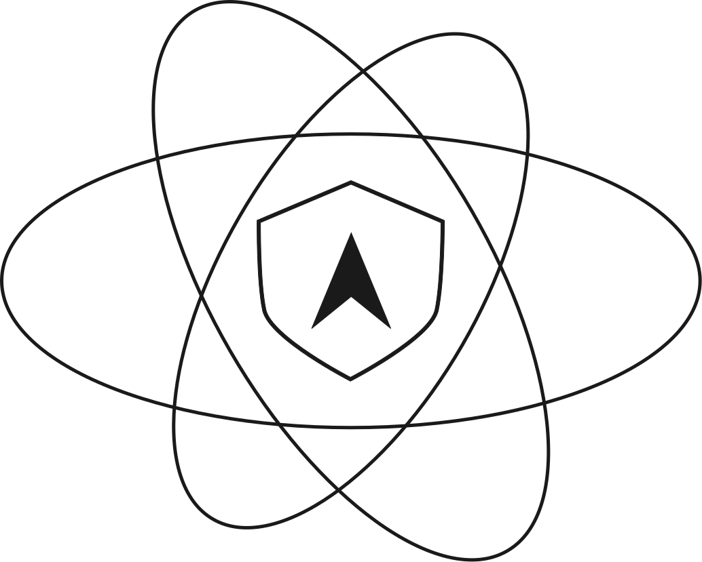

<p align="center">
  <a href="https://ngatoms.com">
    
  </a>
</p>

<h1 align="center">NgAtoms</h1>

<p align="center">Angular UI primitives you own.<br/>No runtime dependency — copy components directly into your project.</p>

<p align="center">
  <a href="https://ngatoms.com"></a>
  <a href="https://www.npmjs.com/package/ngatoms"></a>
  
  
</p>

---

## Quick Start

```bash
# 1. Initialize your project
npx ngatoms init

# 2. Add a component
npx ngatoms add button
```

`init` creates `ngatoms.json` (config), a default theme file, and wires it into your styles.
`add <component>` fetches the component source from GitHub and copies it into your `componentsDir`.

## Commands

### `npx ngatoms init`

Sets up NgAtoms in your Angular project:

- Creates `ngatoms.json` with your `componentsDir` and `stylesFile` paths
- Optionally scaffolds a default CSS theme file
- Adds the theme `@import` to your styles entry point

### `npx ngatoms add <component>`

Copies a component into your project:

- Fetches source files from the NgAtoms registry
- Writes them to `<componentsDir>/<component>/`
- Patches your `stylesFile` with the component's CSS `@import`

```bash
npx ngatoms add button
npx ngatoms add input
npx ngatoms add dialog
```

## Components

Full docs and previews at **[ngatoms.com](https://ngatoms.com)**.

| Component | Description | Status |
|-----------|-------------|--------|
| `accordion` | Collapsible items, single or multiple mode |  |
| `alert` | Feedback messages — 5 variants |  |
| `avatar` | Image with fallback initials or icon |  |
| `badge` | Labels — 7 variants: default, ember, success, warning, destructive, solid, outline |  |
| `button` | 5 variants, 5 sizes, loading state, icon support |  |
| `card` | Container with header, content, footer slots |  |
| `checkbox` | Checked, unchecked, and indeterminate states |  |
| `date-picker` | Custom calendar overlay — single/range, min/max, i18n, month/year picker |  |
| `dialog` | Modal using native `<dialog>`, focus trap, backdrop |  |
| `dropdown-menu` | Contextual action menu — 4 placements, flip, icons, keyboard navigation |  |
| `input` | 3 variants, 5 sizes, invalid state |  |
| `number-input` | Numeric input with increment/decrement controls |  |
| `popover` | Floating content anchored to a trigger — 4 placements, flip |  |
| `progress` | Progress bar — determinate and indeterminate |  |
| `radio-group` | Radio button group with keyboard navigation |  |
| `select` | Styled native select — 3 variants, 5 sizes |  |
| `separator` | Horizontal or vertical divider |  |
| `spinner` | Loading spinner |  |
| `switch` | Toggle switch — 3 sizes |  |
| `tabs` | Underline and pills variants, keyboard navigation |  |
| `textarea` | Multiline input with auto-resize |  |
| `tooltip` | Floating label — 4 placements, viewport clamping |  |
| `breadcrumb` | Hierarchical navigation trail |  |
| `combobox` | Text input with filtered dropdown |  |
| `file-upload` | Drag-and-drop file input zone |  |
| `pagination` | Page navigation controls |  |
| `slider` | Range slider — single and dual thumb |  |
| `stepper` | Multi-step wizard progress indicator |  |
| `tag-input` | Input that creates removable tag chips |  |
| `code-block` | Syntax-highlighted code display |  |
| `color-picker` | HSL/hex color selector |  |
| `context-menu` | Right-click triggered menu |  |
| `drawer` | Side-panel overlay |  |
| `rating` | Star rating input |  |
| `skeleton` | Placeholder loading shimmer |  |
| `timeline` | Vertical event timeline |  |
| `tree` | Collapsible tree view |  |

## Config (`ngatoms.json`)

```json
{
  "componentsDir": "src/components",
  "stylesFile": "src/styles.css",
  "themes": ["src/themes/default.css"]
}
```

## Requirements

- Node >= 18
- Angular >= 21

## License

MIT
